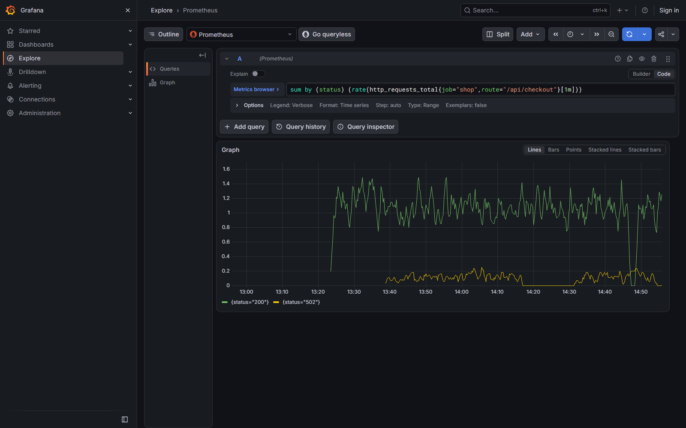
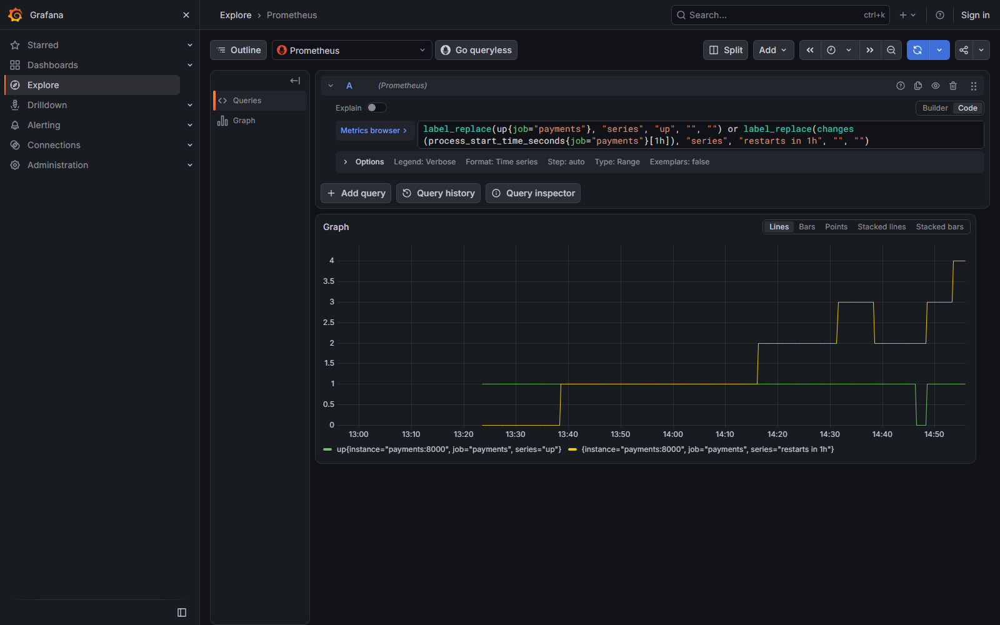
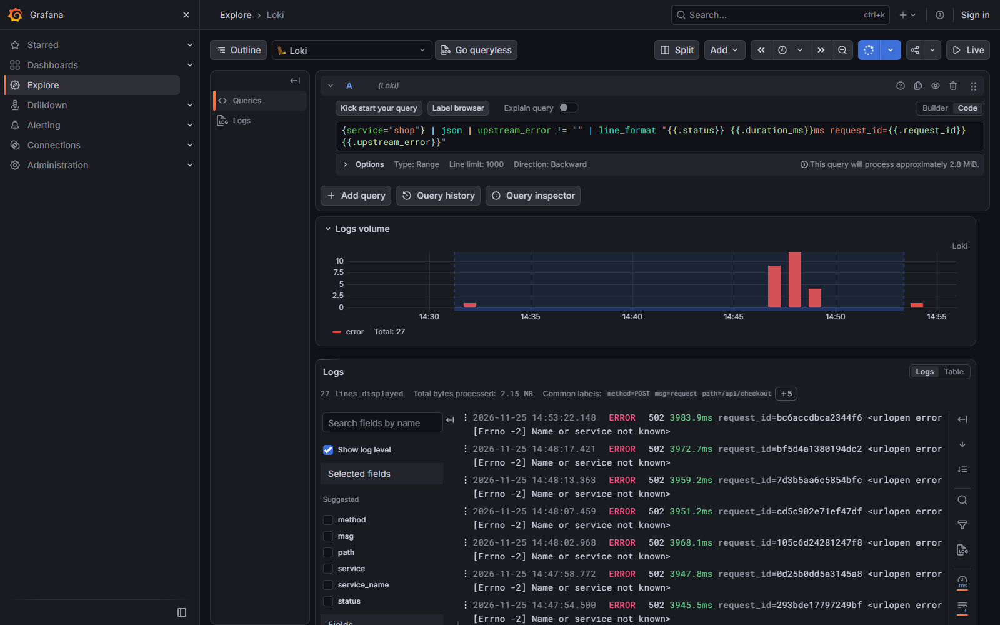

# Postmortem — Checkout failures after payments 1.1.0 release, followed by a payments outage

| | |
|---|---|
| Date | 2026-11-25 (reproduced on the ShopLab stack, Final Challenge) |
| Duration | **22 min 04 s** of customer impact (14:31:14 – 14:53:18 UTC) |
| Severity | SEV-2 — partial checkout outage, 2 minutes full outage of payments |
| Services | `payments` (cause), `shop` /api/checkout (where customers saw it) |
| Status | Resolved by rollback to payments 1.0.0. Blameless: this document is about how the system allowed it. |
| Author / owner of action items | Akylbek Askhat (ID s23068429) |

All times UTC. Raw evidence: [`evidence/deploy-log.txt`](evidence/deploy-log.txt),
[`evidence/webhook-all.txt`](evidence/webhook-all.txt), [`evidence/final-impact.txt`](evidence/final-impact.txt),
[`evidence/final-timeline.txt`](evidence/final-timeline.txt), [`evidence/final-outage-logs.txt`](evidence/final-outage-logs.txt).

## Summary

At 14:31 payments **1.1.0** was deployed; its new unionpay client rejects the KZT currency, so every unionpay
payment (≈ 1 in 10 checkouts) failed with HTTP 500 and customers got "payment failed" (502) from the shop. At
14:46 the payments service was additionally stopped for 2 minutes, during which **every** checkout failed after
hanging ~4 s ("payments unreachable"). The rollback to 1.0.0 at 14:53 ended the impact; 165 of 1 448 checkouts
failed (11.4 %), using about 1.2 % of the 30-day error budget — and the release also wrote full card numbers into
the logs.

## Impact

```promql
# failed / all checkouts during the incident (22m02s ending at the rollback, 14:53:16 = @1795618396)
sum(increase(http_requests_total{job="shop",route="/api/checkout",status=~"5.."}[1322s] @ 1795618396))   # => 165.3
sum(increase(http_requests_total{job="shop",route="/api/checkout"}[1322s] @ 1795618396))                 # => 1448
# the 2-minute outage alone (14:46:16 – 14:48:46)
sum(increase(http_requests_total{job="shop",route="/api/checkout",status=~"5.."}[150s] @ 1795618126))    # => 30  (of 66)
```

| | value |
|---|---|
| failed checkouts | **165** of 1 448 (**11.4 %**) |
| …because of the unionpay bug (payments 500 → shop 502 "payment failed") | ~140 — `sum by (card) (count_over_time({service="payments"} \| json \| msg="request" and status >= 500 [24m]))` → `unionpay 141` |
| …because payments was unreachable (shop 502 "payments unreachable") | ~26 — `sum by (upstream_error) (count_over_time({service="shop"} \| json \| upstream_error != "" [10m]))` → 25 *Name or service not known* + 1 *No address associated* (+1 *Connection refused* at the deploy itself) |
| affected customers | every **unionpay** customer for 22 min (other cards OK), **every** customer for 2 min |
| extra harm | during the outage each checkout **hung ~3.96 s** before failing (`avg_over_time(... \| unwrap duration_ms)` = 3961 ms) |
| duration | 22 min 04 s |
| **error budget** (SLO 99.5 % / 30 days) | 30-day checkout volume at the normal 65 checkouts/min ≈ 2.81 M → budget = 0.5 % ≈ **14 040 failed checkouts** ≈ 216 min of full outage. 165 failed ≈ **1.2 % of the monthly budget** (= 165 / 65 per min ≈ **2.5 min** of full-outage equivalent out of 216). |
| same day, both releases of 1.1.0 (Task 2 at 13:38 + this one) | 443 failed of 6 365 checkouts → ~3.2 % of the monthly budget |
| data protection | payments 1.1.0 logged the full 16-digit `card_number` of **every** payment (not only failed ones) into Loki (7-day retention) — see Root cause #3 |

## Timeline (UTC)

| time | event | evidence |
|---|---|---|
| 14:31:14 | **Deploy payments 1.1.0** (`PAYMENTS_VERSION=1.1.0 docker compose up -d payments`) | `evidence/deploy-log.txt`; process start 14:31:13 in `process_start_time_seconds{job="payments"}`; `changes(process_start_time_seconds{job="payments"}[1h])` = 4 at 14:53 (deploy 14:16 rollback, 14:31 deploy, 14:48 start, 14:53 rollback) |
| 14:31:14.562 | **first error**: shop 502 `Connection refused` while the container was being replaced (no zero-downtime deploy) | LogQL `{service="shop"} \| json \| status=502` (oldest in window) |
| 14:31:16.643 | first unionpay failure: shop 502, `upstream_status: 500`; payments logs `currency KZT not supported by the new unionpay client` | `{service=~"shop\|payments"} \|= "3e5bdaf622b74242"` |
| 14:33:37 | `HighErrorRatio{job="payments"}` pending (for: 5m) | `ALERTS{alertstate="pending"}` |
| 14:35:07 | `CheckoutErrorBudgetFastBurn` pending — fast because the 1h window still held the errors of the first 1.1.0 release at 13:38 | `ALERTS` |
| **14:36:52** | **first alert**: `/pager` `CheckoutErrorBudgetFastBurn` *"burning … 14.7x too fast (7.373% of checkouts fail over 1h)"* — 5.6 min after deploy | `docker compose logs -t webhook` |
| **14:39:06** | **first useful (cause) alert**: `/pager` `HighErrorRatio job=payments` *"payments: 9.485% of requests fail with 5xx"* — points at the right service | webhook log |
| 14:40:16 | `/pager` `HighErrorRatio job=shop` *"3.621%"* (the symptom, same incident) | webhook log |
| 14:46:16 | **payments stopped** (`docker compose stop payments`) — full outage starts | deploy-log; `up{job="payments"}` = 0 from 14:46:23 |
| 14:46:2x–14:48:17 | shop: every checkout 502 *payments unreachable* after ~3.95 s (`[Errno -2] Name or service not known`) | `{service="shop"} \| json \| upstream_error != ""` |
| 14:46:52 / **14:47:26** | `TargetDown{job="payments"}` firing / notified to `/pager` | `ALERTS`, webhook log |
| 14:48:15 | payments started again (still 1.1.0) — outage ends, unionpay errors continue | process start 14:48:15; `up` = 1 at 14:48:23 |
| 14:52:26 | `/pager` RESOLVED `TargetDown` (4 min after recovery — `group_interval: 5m`) | webhook log |
| **14:53:17** | **Rollback to 1.0.0** (`docker compose up -d payments`) | deploy-log; process start 14:53:17 |
| 14:53:22 | last error: 1 checkout failed during the rollback container swap | LogQL last 502 |
| 14:56:51 | RESOLVED `CheckoutErrorBudgetFastBurn` | webhook log |
| 14:59:06 / 15:00:16 | RESOLVED `HighErrorRatio` payments / shop | webhook log |
| ~15:16 / **15:21:03** | `CheckoutErrorBudgetSlowBurn` stops firing (30m window < 3 %) / RESOLVED to `/tickets` — **everything resolved**, 28 min after the rollback (the 30m window has to forget the errors; RESOLVED is sent at the next `group_interval`) | `ALERTS{alertname="CheckoutErrorBudgetSlowBurn"}`, webhook log |





## Detection

- **First signal:** `CheckoutErrorBudgetFastBurn` (page) at **14:36:52**, 5.6 min after the deploy. It told us
  *how bad for customers* (14.7× budget burn) but not *where*.
- **First alert that pointed at the cause:** `HighErrorRatio{job="payments"}` at **14:39:06** (8 min after deploy).
- **Outage:** `TargetDown{job="payments"}` 70 s after the stop — fast and precise.
- **Noise:** `HighErrorRatio{job="shop"}` (the same incident seen from the shop — useful only as confirmation),
  the late RESOLVED of `TargetDown`, and the long-lasting `CheckoutErrorBudgetSlowBurn` *ticket* which stayed open
  from the first release (13:51) and therefore did not notify again for this one. With the **starter config**
  the same night produced ~40+ `ErrorsDetected` notifications (one per route/status, every minute, including
  random `/api/search` 500s) — the real alert would have been lost in them (Task 3: 59 notifications in 30 min).
- **Not detected at all by alerts:** the card numbers in the logs. Nothing watches log content.
- 8 minutes from deploy to a precise alert is too slow for a release that broke 10 % of payments instantly:
  the deploy itself should have been the detector (canary / per-version error ratio).

## Root cause

1. **The 1.1.0 unionpay client does not support KZT.** All failed payments are unionpay on 1.1.0, and only
   after the deploy:
   ```promql
   sum by (job, route, status) (rate(http_requests_total{status=~"5.."}[5m]))
   #  payments /api/pay 500  +  shop /api/checkout 502  (search 500 = known background)
   ```
   ```logql
   sum by (card, version) (count_over_time({service="payments"} | json | msg="request" and status >= 500 [24m]))
   #  {card="unionpay", version="1.1.0"} => 141      (visa, mastercard, 1.0.0: none)
   {service="payments"} | json | level="ERROR" | msg != "request"
   #  "currency KZT not supported by the new unionpay client"
   ```
   Error ratio goes back to 0 after the rollback (`slo:checkout_error_ratio:rate5m` → 0 at ~14:58).
   *How the system allowed it:* the release went to 100 % of traffic at once (no canary), no test covers
   unionpay + KZT (our main currency), and there is no automated rollback on error ratio by version.
2. **The payments outage** (14:46–14:48) — payments was stopped and nothing replaced it: one instance, no
   health-checked replica, no retry/fallback in the shop. The shop's 3 s timeout plus a failing DNS lookup made
   every checkout hang ~4 s before failing — slow *and* failed.
   ```promql
   up{job="payments"}                                          # 0 from 14:46:23 to 14:48:13
   changes(process_start_time_seconds{job="payments"}[1h])     # restarts / deploys
   ```
3. **Card numbers in logs** (data leak, discovered during the investigation): payments 1.1.0 adds the full
   `card_number` to every request log line.
   ```logql
   {service="payments"} |~ `[0-9]{16}`
   sum by (version) (count_over_time({service="payments"} |~ `[0-9]{16}` | json [1h]))   # only version="1.1.0"
   ```
   *How the system allowed it:* the logger dumps arbitrary request fields (`g.extra`) without a redaction
   filter, there is no log-content check in CI, and code review did not flag it.

## What went well

- The SLO burn-rate alert and the per-service `HighErrorRatio` (from Task 3) paged with a **number and a runbook**,
  routed to `/pager` only — 3 pages for the incident instead of a wall of `errors!!!`.
- `TargetDown` caught the outage in 70 s.
- `request_id` propagation made the root cause obvious in one LogQL query: shop 502 → payments 500 →
  "currency KZT not supported" (Task 4).
- The rollback was one command and fixed the problem within 5 minutes; the deploy log + `process_start_time_seconds`
  gave exact deploy/restart times for this timeline.

## What went badly

- The same broken version was **deployed twice** the same day (13:38 and 14:31): nothing blocked a version that
  had already failed.
- Time to rollback was **22 min** although the precise alert came after 8 min.
- The slow-burn **ticket** from the first release was still open, so it said nothing new — and a one-hour-old
  ticket nobody had acted on is itself a problem.
- During the outage customers waited ~4 s for an error (no fast failure, no circuit breaker).
- Every deploy and rollback cost a failed request (container swap, no graceful/zero-downtime rollout).
- Card numbers were written to Loki for 22 minutes (plus the earlier release) and stay there up to 7 days.
- One incident still produced three separate pages (SLO burn, shop symptom, payments cause): no inhibition.

## Action items

| # | action | type | owner | priority |
|---|---|---|---|---|
| 1 | **Canary release for payments** (week 12): send 5–10 % of traffic to the new version first, compare `sum by (version) (rate(http_requests_total{status=~"5.."}[5m]))` with the stable version and auto-rollback if the canary's error ratio is > 2× the baseline. Add the `version` label to the metrics to make this possible. | prevent | me | P1 |
| 2 | **Integration test for every card type × KZT** in the payments CI pipeline (unionpay + KZT would have failed before merge). | prevent | me | P1 |
| 3 | **Log redaction**: payments logs at most the last 4 digits (`card_last4`), plus a CI check / LogQL alert on `{service="payments"} \|~ "[0-9]{16}"` → page security. Delete the already stored lines (Loki delete API / shorten retention) and treat it as a data incident. | prevent + detect | me | P1 |
| 4 | **Per-version error-ratio alert / deploy annotation**: alert when a version deployed < 1 h ago has an error ratio > 2 % (`HighErrorRatioNewVersion`), and show deploys as annotations on the "ShopLab — RED" dashboard. Would have paged ~5 min after 14:31 with "payments 1.1.0" in the text. | detect | me | P2 |
| 5 | **Inhibition**: suppress `HighErrorRatio{job="shop"}` while `HighErrorRatio{job="payments"}` or `TargetDown{job="payments"}` fires — one page per incident, pointing at the cause. | detect | me | P2 |
| 6 | **Fail fast in the shop**: lower the payments timeout to ~1 s, add a circuit breaker and a clear "payments temporarily unavailable, try again" response; run ≥ 2 payments replicas with health checks so a single stop is not an outage. | mitigate | me | P2 |
| 7 | **Block re-deploying a version that was rolled back** (release checklist / pipeline flag "1.1.0 = bad") and **auto-rollback** when the fast-burn alert fires within 30 min of a deploy. | mitigate | me | P3 |

## Lessons

The error budget did its job as a measuring stick (1.2 % spent, visible on the dashboard), but alerts on the
budget are designed for *sustained* problems and fire minutes later; a bad release must be caught by the release
process itself (canary + version-aware metrics), not by burning the budget. And observability data is data:
what we log can become the incident.
