# Lab 14 — Report (Variant A)

**Student:** Akylbek Askhat (ID s23068429)

Stack: ShopLab (shop, payments, traffic, Prometheus v3.16.0, Alertmanager v0.35.0, Loki 3.6.22, Alloy v1.22.0,
Grafana 13.3.1) on Docker Desktop, Windows 11. All times are **UTC**. Raw text output of every query below is in
[`evidence/`](evidence/), screenshots in [`screenshots/`](screenshots/).

`app.py` was treated as a black box: every finding below came from a metric or a log query first; the code was
opened only to confirm it (Task 4 asks for the line explicitly).

## Run log (UTC) — what ran when

| time | action | used for |
|---|---|---|
| 13:23:12 | `docker compose up -d --build` — 9 services up, payments 1.0.0, **starter** rules + routing (+ Task 2 SLO rules added 13:24) | Task 1, Task 3 "before" (1.0.0 phase) |
| **13:38:22** | **deploy payments 1.1.0** | Task 2 (38 min), Task 3 "before" (1.1.0 phase), Task 4 |
| **14:16:03** | **rollback 1.0.0**; 14:16:04 final `rules.yml` + `alertmanager.yml` loaded | end of Task 2, start of Task 3 "after" |
| **14:31:14** | **deploy payments 1.1.0** | Task 3 "after" (1.1.0 phase) + **Final Challenge** start |
| **14:46:16 – 14:48:16** | `docker compose stop payments` / `start` | Final Challenge outage |
| **14:53:17** | **rollback 1.0.0** | Final Challenge end |
| 15:21:03 | last alert resolved (`CheckoutErrorBudgetSlowBurn` → `/tickets`) | Final Challenge "resolved" |
| 15:22:06 | `docker compose down && docker compose up -d` | Task 5 (dashboard loads by itself) |
| 17:22:39 | stack up again; own request `X-Request-ID: lab-akylbek-1` (payments 1.0.0) | Task 4 |
| 17:22:42 – 17:22:50 | payments 1.1.0 for 8 s; own request `lab-akylbek-2` | Task 4 (payments logs lost, see there) |
| 17:23:40 – 17:24:35 | payments 1.1.0 again; own request `lab-akylbek-3` at 17:24:13 | Task 4 |

`evidence/deploy-log.txt` was written by the same command that did the deploy (`date -u` right after it).

How screenshots were taken: Grafana Explore / dashboard and the Prometheus / Alertmanager UIs, rendered with
headless Chrome against the local stack (Grafana org timezone set to UTC). Query text output was produced with
the Prometheus HTTP API (`/api/v1/query`, `/api/v1/query_range`) and the Loki API (`/loki/api/v1/query_range`).

---

## Task 1 — "Search is slow"

Data: payments 1.0.0, ~5 min of traffic after start (13:23 → 13:28).

### Average vs p50 vs p95 per route (`job="shop"`)

```promql
# average
sum by (route) (rate(http_request_duration_seconds_sum{job="shop"}[5m]))
  / sum by (route) (rate(http_request_duration_seconds_count{job="shop"}[5m]))
# p50 / p95 / p99
histogram_quantile(0.50, sum by (route, le) (rate(http_request_duration_seconds_bucket{job="shop"}[5m])))
histogram_quantile(0.95, sum by (route, le) (rate(http_request_duration_seconds_bucket{job="shop"}[5m])))
histogram_quantile(0.99, sum by (route, le) (rate(http_request_duration_seconds_bucket{job="shop"}[5m])))
```

| route | average | p50 | **p95** | p99 |
|---|---|---|---|---|
| `/api/search` | 132 ms | 42 ms | **1.39 s** | 2.28 s |
| `/api/checkout` | 57 ms | 61 ms | 96 ms | 99 ms |

The average (132 ms) and the median (42 ms) of search look healthy. The p95 is **1.39 s**: one search in twenty
takes more than a second. Checkout is fine on every statistic, so the problem is **`/api/search` only**.

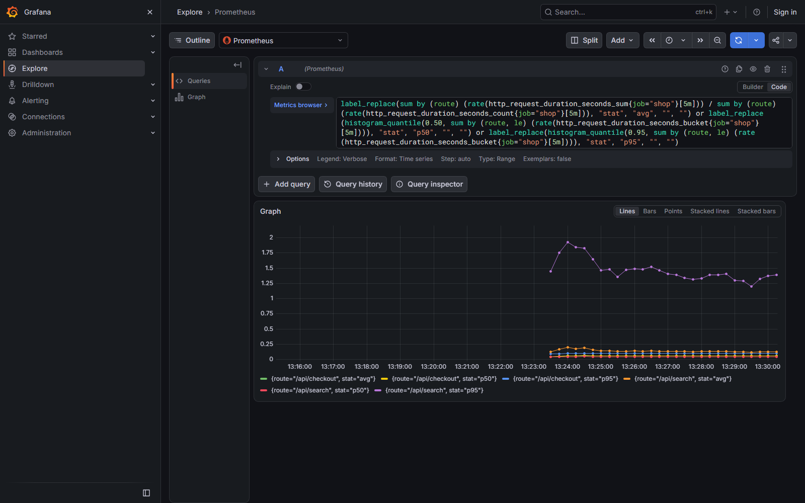

### Share of searches slower than 0.5 s

```promql
1 - sum(rate(http_request_duration_seconds_bucket{job="shop",route="/api/search",le="0.5"}[5m]))
  / sum(rate(http_request_duration_seconds_count{job="shop",route="/api/search"}[5m]))
```
Result: **0.082 → 8.2 %** of searches are slower than 500 ms (stable at 7–9 % over time).

The bucket distribution makes the shape obvious — a gap between 0.1 s and 0.75 s, then a second cluster at 1–2.5 s:
```promql
sum by (le) (increase(http_request_duration_seconds_bucket{job="shop",route="/api/search"}[5m]))
```
```
le=0.05 554   le=0.1 746   le=0.25 746   le=0.5 746   le=0.75 746   le=1 757   le=2.5 812   le=+Inf 812
```
→ 746 of 812 searches finish in < 100 ms; the other 66 (8 %) take 0.75–2.5 s. Two populations, not "slightly slow".

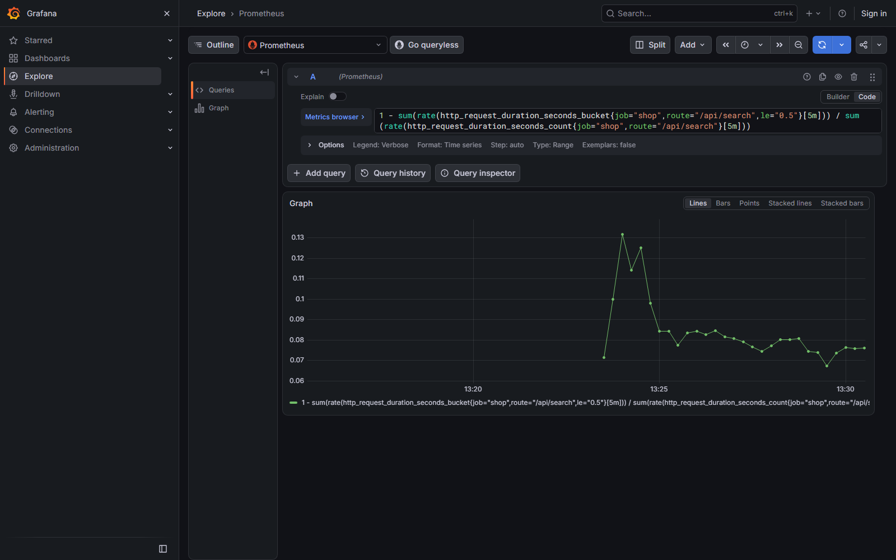

### What do the slow searches have in common? (LogQL)

```logql
{service="shop"} | json | path="/api/search" and duration_ms > 500 | line_format "{{.duration_ms}}ms q={{.query}}"
```
```
1216.8ms q=phone tea pen book bag chair
1031.4ms q=tea book laptop shoes chair chair
1314.4ms q=laptop pen bag kazakh book book
1204.2ms q=book pen pen lamp bag tea
 953.0ms q=phone pen kazakh phone shoes book
1416.2ms q=tea bag shoes bag kazakh book
...
```
Compare with all searches:
```logql
{service="shop"} | json | path="/api/search" | line_format "{{.duration_ms}}ms q={{.query}}"
```
```
60.0ms q=lamp
47.7ms q=book chair
1354.3ms q=book laptop bag book bag tea
29.9ms q=tea
```
**Pattern:** every slow search is a **long query — 6 words, more than 20 characters**. Short queries (1–2 words)
are never slow.

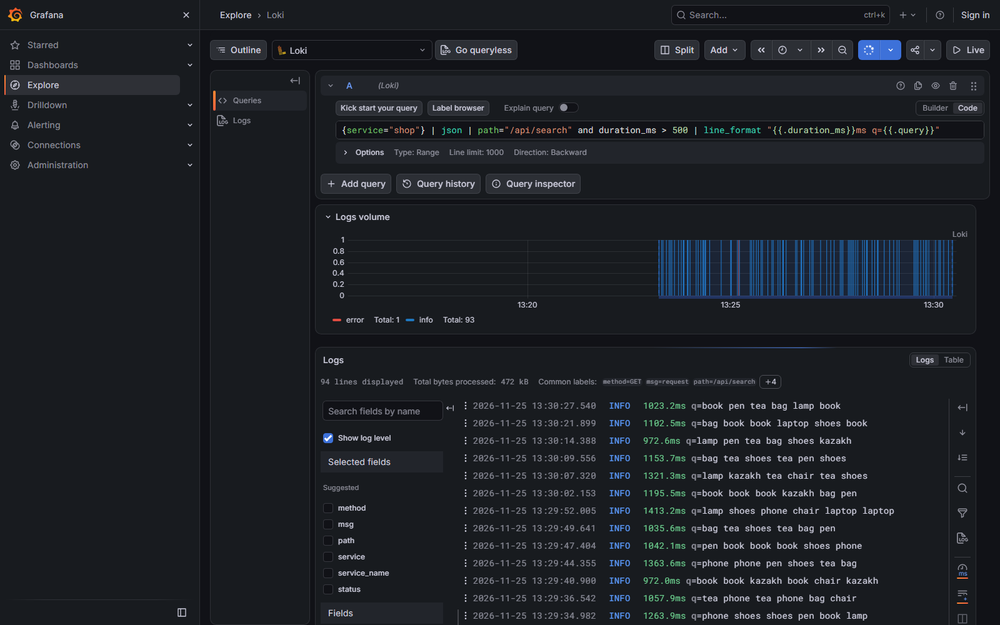

### Bonus — proving the pattern with one LogQL metric query

```logql
avg by (long) (avg_over_time({service="shop"} | json | path="/api/search"
  | label_format long=`{{ if gt (len .query) 20 }}yes{{ else }}no{{ end }}` | unwrap duration_ms [5m]))
```
| long query (> 20 chars) | count (5 min) | avg duration | slower than 500 ms |
|---|---|---|---|
| no | 750 | **40 ms** | 0 |
| yes | 65 | **1181 ms** | **65 (100 %)** |

(counts: `sum by (long) (count_over_time(... [5m]))`, with and without `and duration_ms > 500`).
65 / 815 = 8.0 % — exactly the share of slow requests the histogram showed. Only then did I open `app.py`
to confirm: `if len(q) > 20: time.sleep(random.uniform(0.9, 1.4))`.

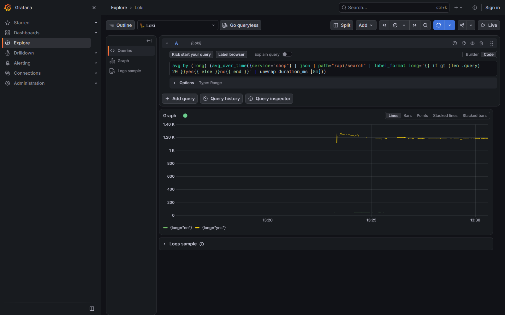

### Explain

**Why does the average look fine while some users wait more than a second?** 92 % of searches take ~40 ms and
8 % take ~1.2 s. The average (0.92·40 + 0.08·1200 ≈ 130 ms) mixes both groups into a number nobody actually
experiences, and the median is by definition the "typical" request — it ignores the slowest half completely.
A tail that affects 1 in 12 requests is invisible in both; only a high percentile (p95/p99) or a
"share slower than X" ratio shows it. Every active user does many searches, so most users hit the slow tail
regularly.

**Why do you need both metrics and logs?** Metrics are cheap aggregates with few labels (`route`, `status`):
they tell **where** (route `/api/search`), **when** and **how much** (8 %, p95 1.4 s), but they cannot carry
high-cardinality data such as the query text. Logs keep every request with all its fields (query, duration,
request_id), so they answer **what** the slow requests have in common — but you would never find the needle in
millions of lines without the metric telling you where to look. Metrics → narrow down, logs → explain.

---

## Task 2 — An SLO for checkout, and a burn-rate alert

**SLO:** 99.5 % of checkouts succeed over 30 days → error budget = 0.5 %.

**Error budget in minutes:** 30 days × 24 h × 60 min = 43 200 min; 43 200 × 0.005 = **216 minutes**
(3 h 36 min) of "checkout fully down" per 30 days. Equivalently: 1 failed checkout out of every 200.

### Recording rules (`monitoring/rules.yml`, group `slo-checkout-recording`)

```yaml
- record: slo:checkout_error_ratio:rate5m      # same for 30m, 1h, 6h
  expr: |
    (sum(rate(http_requests_total{job="shop",route="/api/checkout",status=~"5.."}[5m])) or vector(0))
    / sum(rate(http_requests_total{job="shop",route="/api/checkout"}[5m]))
- record: slo:checkout_burn_rate:rate1h        # for the dashboard
  expr: slo:checkout_error_ratio:rate1h / 0.005
```
`or vector(0)`: without it the ratio is *empty* (not 0) while checkout has no 5xx at all — see Task 5.

### Alerts (group `slo-checkout-alerts`)

```yaml
- alert: CheckoutErrorBudgetFastBurn
  expr: |
    slo:checkout_error_ratio:rate1h > (14.4 * 0.005)
    and
    slo:checkout_error_ratio:rate5m > (14.4 * 0.005)
  for: 1m
  labels: { severity: page, service: shop, slo: checkout-availability }
  annotations:
    summary: Checkout is burning its 30-day error budget {{ burn rate 1h }}x too fast ({{ $value | humanizePercentage }} of checkouts fail over 1h; SLO 99.5 %)
    runbook_url: …/runbooks/checkout-slo.md
- alert: CheckoutErrorBudgetSlowBurn
  expr: |
    slo:checkout_error_ratio:rate6h > (6 * 0.005)
    and
    slo:checkout_error_ratio:rate30m > (6 * 0.005)
  for: 5m
  labels: { severity: ticket, service: shop, slo: checkout-availability }
```
(the burn-rate number in the summary is computed with `{{ with query "slo:checkout_burn_rate:rate1h" }}…` —
Prometheus templates have no `div`, my first version was rejected on reload: `function "div" not defined`.)

Runbook: [`runbooks/checkout-slo.md`](runbooks/checkout-slo.md).

```bash
docker run --rm -v "$PWD/monitoring:/m" --entrypoint promtool prom/prometheus:v3.16.0 check rules /m/rules.yml
#   SUCCESS: 10 rules found
curl -X POST localhost:9090/-/reload
```

### The experiment: payments 1.1.0 from 13:38:22 to 14:16:03 (37.7 min)

```promql
ALERTS{alertname=~"Checkout.*"}
slo:checkout_error_ratio:rate1h / 0.005      # burn rate 1h
slo:checkout_error_ratio:rate5m / 0.005      # burn rate 5m
```

| time (UTC) | event | burn 5m | burn 1h | evidence |
|---|---|---|---|---|
| 13:23:12 | stack started, payments 1.0.0 | 0 | 0 | |
| 13:38:22 | **deploy payments 1.1.0** | 0 | 0 | `evidence/deploy-log.txt` |
| 13:39 | first 502 on checkout | 3.7× | 1.1× | `{service="shop"} \| json \| status=502` |
| 13:43 | 5m window already > 14.4× | 14.4× | 3.5× | the short window alone would page now |
| 13:46:19 | `CheckoutErrorBudgetSlowBurn` **pending** (6h & 30m > 6×) | 17× | 5.1× | `ALERTS{alertstate="pending"}` |
| **13:51:19** | **`CheckoutErrorBudgetSlowBurn` firing** (`severity: ticket`) — 13 min after deploy | 17–22× | 8.1× | webhook 13:51:22 *"burning … 8.1x too fast (4.052% of checkouts fail over 6h)"* |
| 14:13:53 | `CheckoutErrorBudgetFastBurn` **pending** (1h crossed 14.4×) | 23× | 14.3× | |
| **14:14:53** | **`CheckoutErrorBudgetFastBurn` firing** (`severity: page`) — **36.5 min after deploy** | 23× | **14.5×** | webhook 14:14:52 *"burning … 14.5x too fast (7.246% of checkouts fail over 1h)"* |
| 14:16:03 | rollback to 1.0.0 | | | |

At the moment the page fired: error ratio 5m = 11.6 %, 30m = 10.6 %, 1h = 7.28 % → **burn rate 14.5× (1h)
and 23× (5m)**. The real error rate during the whole release was ~11 % (≈ every unionpay checkout = 1 in 10).

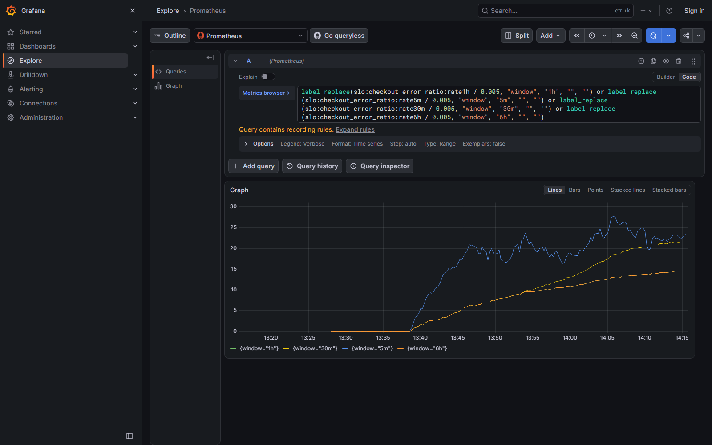
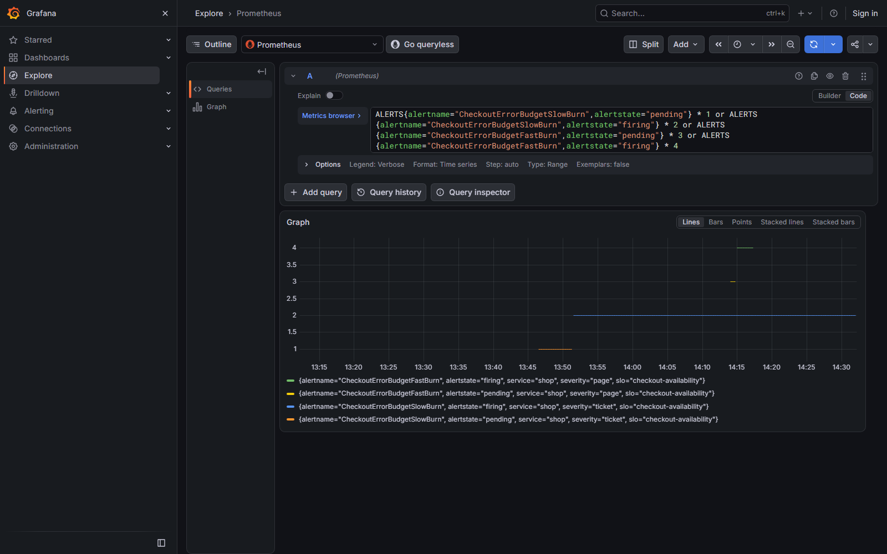
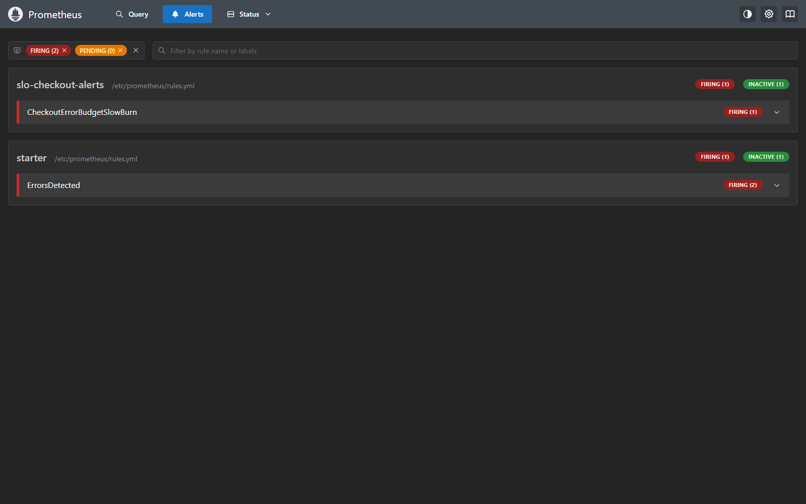
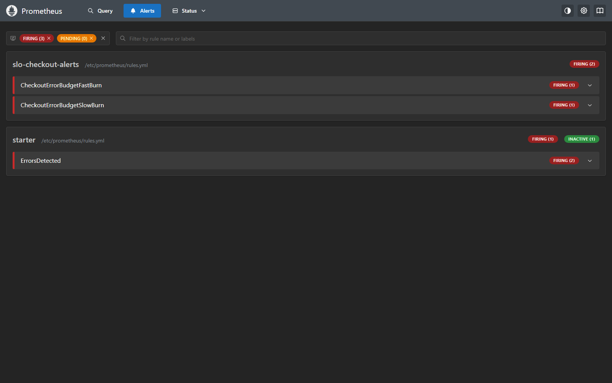

### Explain

**Why alert on the burn rate instead of "error ratio > 0.5 %"?** "> 0.5 %" fires on any short blip — 1 failed
checkout out of 150 in a 5-minute window — and says nothing about urgency: 0.6 % and 100 % errors look the same.
The burn rate measures **how fast the monthly budget is being spent**: burn 1 = we would use exactly the budget in
30 days (fine, that is what it is for); 14.4 = 2 % of the monthly budget gone in one hour, budget empty in ~2
days → wake someone up; 6 = 5 % in 6 hours → a ticket for tomorrow. The threshold is tied to the business
promise (the SLO), so urgency is proportional to impact, and slow small error rates that never threaten the SLO
don't page anybody.

**Why two windows per alert?** The **long** window (1h / 6h) makes the alert *significant*: enough budget has
really been spent, a 2-minute spike can't trigger a page. The **short** window (5m / 30m) makes it *current*:
it must still be burning now. Without the short window the alert would keep firing for up to an hour after the
rollback (the 1h average only decays slowly — here the 1h burn was still > 14 for many minutes after 14:16);
with it, the alert resolves within ~5 minutes of the fix. Long = precision, short = fast reset.

**Why didn't the fast-burn alert fire soon after the deploy, although the error ratio jumped at once?** The 5m
window crossed 14.4× within 5 minutes (13:43), but the page needs the **1-hour** average above 7.2 % too.
With a real error rate of ~11 %, the 1h average climbs linearly from 0 and reaches 7.2 % only after
≈ 0.072 / 0.11 ≈ 65 % of the hour of errors — here **36.5 min** (a bit faster than the theoretical ~39 min
because the stack had only 15 min of healthy history in its 1h window). That is by design: an 11 % error rate is
a *medium* incident (22× burn — it eats the budget in ~33 h). A full outage (100 % errors, 200× burn) would
cross the 1h threshold after 0.072 × 60 ≈ **4.3 min**. The slow-burn ticket was faster here (13 min) only
because the 6h window contained just 15–45 min of data; with 6 full hours of history it would need
~0.03/0.11 × 6 h ≈ 1.6 h. In production you'd catch this release earlier with a canary or a per-version alert,
not by burning the budget.


---

## Task 3 — The noisy alert

### Before: the starter config (`monitoring/rules.starter.yml`, `monitoring/alertmanager.starter.yml`)

Window: 13:23:12 – 13:53:22 = payments **1.0.0 for 15 min**, then **1.1.0 for 15 min** (deploy 13:38:22).

```bash
docker compose logs -t --no-log-prefix webhook   # saved: evidence/task3-before-webhook.txt
grep -c FIRING …
```

| phase | notifications | what they were |
|---|---|---|
| payments **1.0.0** (healthy), 15 min | **16** (13 FIRING + 3 RESOLVED) | 100 % `ErrorsDetected route=/api/search status=500` — the random 0.5 % search error, flapping |
| payments **1.1.0** (broken), 15 min | **43** (38 FIRING + 5 RESOLVED) | 14× `/api/checkout 502` + 13× `/api/pay 500` (the same incident, twice, repeated every minute) + 14× more `/api/search 500` noise + 2× `CheckoutErrorBudgetSlowBurn` |
| **total 30 min** | **59** — all to one channel `/everyone`, all `severity: page` | |

Example of what the on-call phone showed (all to the same `/everyone` channel, all `severity: page`):
```
13:52:37 /everyone [FIRING] ErrorsDetected {'instance': 'payments:8000', 'job': 'payments', 'method': 'POST', 'route': '/api/pay', 'severity': 'page', 'status': '500'} :: errors!!!
13:52:42 /everyone [FIRING] ErrorsDetected {'instance': 'shop:8000', 'job': 'shop', 'method': 'POST', 'route': '/api/checkout', 'severity': 'page', 'status': '502'} :: errors!!!
13:52:47 /everyone [FIRING] ErrorsDetected {'instance': 'shop:8000', 'job': 'shop', 'method': 'GET', 'route': '/api/search', 'severity': 'page', 'status': '500'} :: errors!!!
```
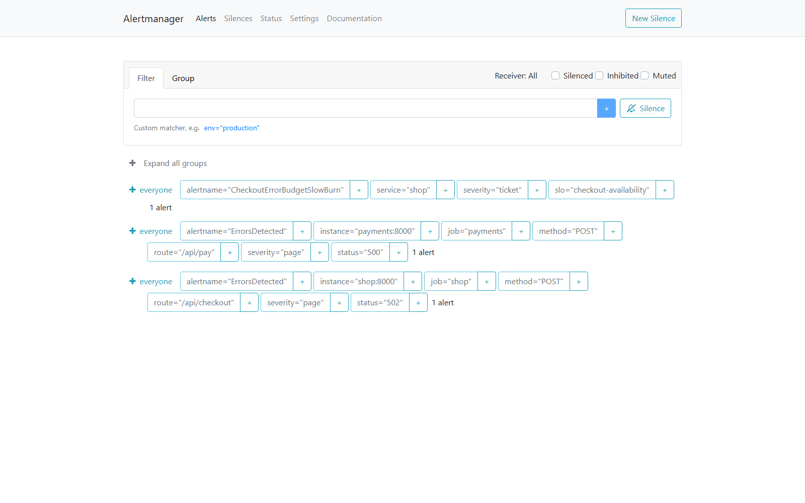

**Which of them needed a human?** Only **one problem** happened in these 30 minutes: the 1.1.0 release breaking
unionpay payments. It deserved **one** page (or one ticket) when it started. Everything else was noise:
- all `/api/search 500` notifications (FIRING/RESOLVED flapping all 30 minutes, also with the healthy 1.0.0) —
  the known 0.5 % random error, ~0.35 % of shop traffic, nobody can or should act on it;
- the separate `/api/checkout 502` and `/api/pay 500` notifications — the *same* incident seen twice
  (symptom in shop + cause in payments), each one repeated every minute (`repeat_interval: 1m`);
- the message itself (`errors!!!`) had no number, no service-level summary and no runbook, so even the
  one useful notification didn't tell the on-call what to do.

### The fix

**New alert** (`monitoring/rules.yml`, group `availability`) — replaces `ErrorsDetected`:
```yaml
- alert: HighErrorRatio
  expr: |
    (
      sum by (job) (rate(http_requests_total{status=~"5.."}[5m]))
      / sum by (job) (rate(http_requests_total[5m]))
    ) > 0.02                                      # a ratio, not "any error"; 2 % >> 0.35 % baseline noise
    and on (job)
    sum by (job) (rate(http_requests_total[5m])) > 0.2   # minimum traffic: no page for 1 error out of 3 requests
  for: 5m                                         # must last 5 minutes, no flapping on spikes
  labels: { severity: page }
  annotations:
    summary: "{{ $labels.job }}: {{ $value | humanizePercentage }} of requests fail with 5xx over 5m (threshold 2 %)"
    runbook_url: https://github.com/askhat06/lab14-incidents/blob/main/runbooks/high-error-ratio.md
```
`sum by (job)` = one alert **per service**, not per method/route/status/instance combination.
`TargetDown` got a better summary and a runbook too. Runbooks: `runbooks/high-error-ratio.md`, `runbooks/target-down.md`.

**New routing** (`monitoring/alertmanager.yml`):
```yaml
route:
  receiver: tickets
  group_by: [alertname, job]     # was ["..."] = every label combination is its own notification
  group_wait: 30s                # was 0s: collect alerts that start together into one message
  group_interval: 5m             # was 10s
  repeat_interval: 4h            # was 1m: a firing alert is re-sent every 4 h, not every minute
  routes:
    - matchers: [severity="page"]
      receiver: pager            # /pager (phone) only for severity=page
      repeat_interval: 1h
receivers: pager -> http://webhook:8080/pager, tickets -> http://webhook:8080/tickets (send_resolved: true)
```
```bash
docker run --rm -v "$PWD/monitoring:/m" --entrypoint amtool prom/alertmanager:v0.35.0 check-config /m/alertmanager.yml
#   SUCCESS … - 2 receivers
curl -X POST localhost:9090/-/reload ; curl -X POST localhost:9093/-/reload      # 14:16:04
```

### After: the same 30 minutes

Window: 14:16:04 – 14:46:14 = payments **1.0.0 for 15 min** (rollback 14:16:03), then **1.1.0 for 15 min**
(deploy 14:31:14).

| phase | notifications | what they were |
|---|---|---|
| payments **1.0.0** (healthy), 15 min | **8**, all at 14:16:04 and 14:21:04 — **0 new problems** | one-time effects of switching the config while the Task 2 incident was still open: 5× leftover `ErrorsDetected` (Alertmanager re-routed the still-open old alerts to `/pager` and then resolved them because the rule no longer exists), the open `CheckoutErrorBudgetFastBurn` / `SlowBurn` delivered once to their new receivers, and the fast burn RESOLVED 5 min after the rollback. **No search noise at all.** |
| payments **1.1.0** (broken), 15 min | **3** | 14:36:52 `/pager` `CheckoutErrorBudgetFastBurn` *"14.7x too fast (7.373% of checkouts fail over 1h)"*; 14:39:06 `/pager` `HighErrorRatio job=payments` *"9.485% of requests fail"*; 14:40:16 `/pager` `HighErrorRatio job=shop` *"3.621% of requests fail"* |
| **total 30 min** | **11** (6 without the one-time leftovers of the removed rule) | `/pager` 10, `/tickets` 1 |

### Before / after

| | before (starter) | after (final) |
|---|---|---|
| notifications in 30 min | **59** | **11** (6 excluding one-time switch leftovers) |
| …while everything was healthy (1.0.0) | 16 | 0 new (only leftovers of the previous incident) |
| …during the real incident (1.1.0, 15 min) | 43 | **3** |
| `/api/search 500` noise | 30 (22 FIRING + 8 RESOLVED) | **0** |
| repeats of an already-known alert | every minute (`repeat_interval: 1m`) | none (`4h`, pager `1h`) |
| channels | `/everyone`, everything is a page | `/pager` for `severity=page`, `/tickets` for the rest |
| text | `errors!!!` | service, percentage, threshold + `runbook_url` |
| notifications that needed a human | 1 problem hidden among 59 | 3 pages, all about the one real problem, first one 5.6 min after the deploy |

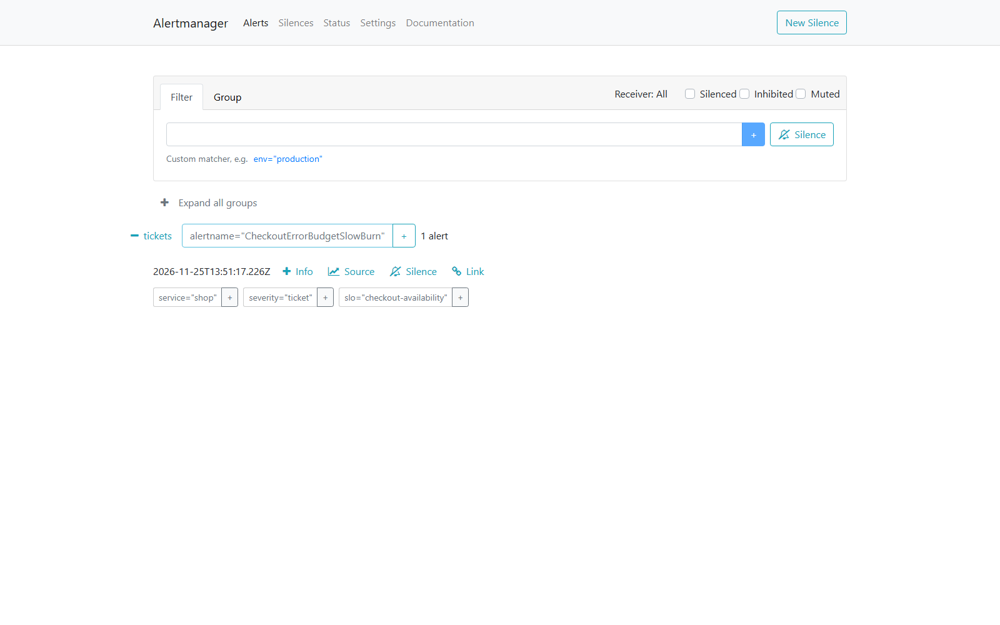

Raw logs: `evidence/task3-before-webhook.txt`, `evidence/task3-after-webhook.txt`; counting script output: `evidence/task3-counts.txt`.

**Still not perfect:** during the incident one problem produced three pages (SLO burn on shop, error ratio on
shop = symptom, error ratio on payments = cause). With `group_by: [alertname, job]` they are separate groups.
Next steps would be an inhibition rule (`HighErrorRatio{job="shop"}` suppressed while the checkout SLO alert or
`HighErrorRatio{job="payments"}` fires) or grouping by incident/service owner. Note also that the fast-burn
alert fired only 5.6 min after this second deploy (vs 36.5 min the first time) because the 1h window still
contained the errors of the first release — a repeat of a bad release eats a budget that is already low.

### Explain

**What is alert fatigue and why is it dangerous?** When most notifications are noise, people stop reading
them: they mute the channel (as the on-call here did), swipe pages away, or assume "it's the usual". Then the
one real alert — payments failing every unionpay customer — arrives in the same channel, with the same
`errors!!!` text, between 30 search flaps, and is ignored. Fatigue turns monitoring into a false sense of safety;
it also burns people out and makes them distrust the whole alerting system.

**What makes an alert actionable?** (1) It describes a **user-visible symptom** that matters (SLO / error ratio,
not "a 500 happened"). (2) It needs **a human, now** — if nobody has to do anything, it is a dashboard or a
ticket, not a page. (3) It is **one notification per problem** (grouped, deduplicated, not repeated every
minute). (4) It **tells what to do**: which service, how bad (the number in the summary), since when, and a
`runbook_url` with the first queries and mitigations. (5) It is routed by **severity** to the right place
(pager vs ticket).

**Why does a single 500 on `/api/search` not deserve a page?** It is a 0.5 % random error that the user fixes by
retrying ("try again"), it does not threaten any SLO, and there is nothing the on-call engineer can do at 3 a.m.
to fix it. Paging on it costs a person's sleep and trust in the pager for zero user benefit. If it ever grows
(ratio over a threshold for minutes, or it burns a search SLO), the ratio/burn-rate alerts will catch it; a
single event is something to look at in a dashboard or log query, not a page.


---

## Task 4 — Follow one checkout across two services

### A real failing checkout from the shop's logs

```logql
{service="shop"} | json | status=502
```
```
{"ts":"2026-11-25T13:39:07.694+00:00","level":"ERROR","service":"shop","version":"1.0.0","msg":"request",
 "request_id":"f6a3d075a1754aac","method":"POST","path":"/api/checkout","status":502,"duration_ms":44.9,
 "card":"unionpay","upstream_status":500}
```
The customer's screenshot says **`X-Request-ID: f6a3d075a1754aac`**. One query, both services:

```logql
{service=~"shop|payments"} |= "f6a3d075a1754aac"
```
```
13:39:07.694 shop     v1.0.0 ERROR POST /api/checkout status=502 card=unionpay upstream_status=500
13:39:07.694 payments v1.1.0 ERROR POST /api/pay      status=500 card=unionpay amount=10421 card_number=7278…
13:39:07.694 payments v1.1.0 ERROR "currency KZT not supported by the new unionpay client"
```
The story in three lines: the customer paid with **unionpay**, **payments 1.1.0** could not handle the KZT
currency in its new unionpay client and answered 500, and the shop turned that into a 502 "payment failed" for
the customer. (Also visible: payments 1.1.0 logs the full `card_number` — a data leak, see the postmortem. In the files in
`evidence/` the numbers are masked to the last 4 digits; they were random test numbers from `traffic.py`.)

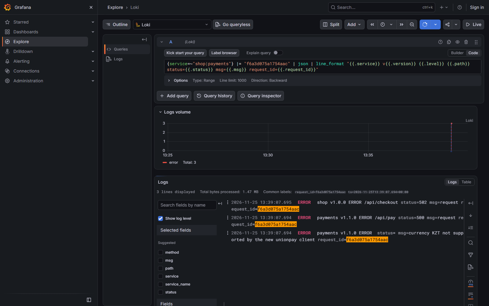
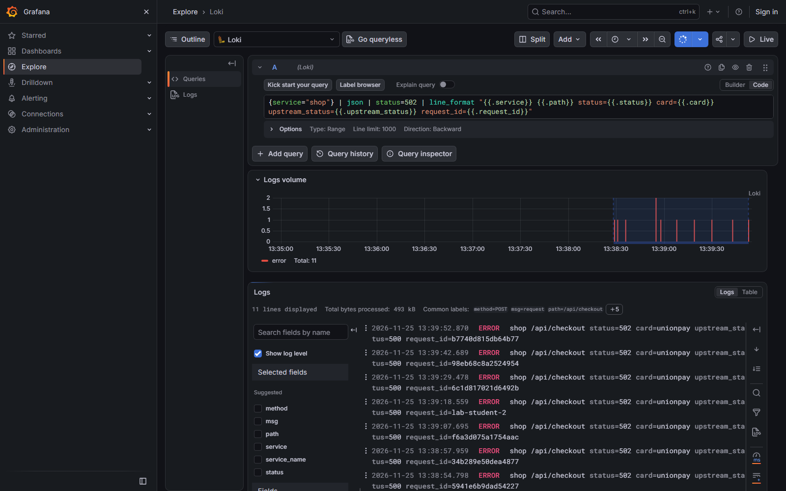

### My own request with a chosen ID

```bash
curl -si -X POST localhost:8000/api/checkout -H 'X-Request-ID: lab-akylbek-1'   -H 'Content-Type: application/json' -d '{"card":"unionpay","amount":1000,"card_number":"4000000000000000"}'
```
- on payments **1.0.0** (17:22:39): `HTTP/1.1 200 OK`, response header `X-Request-ID: lab-akylbek-1`
- the same body as `lab-akylbek-3` on payments **1.1.0** (17:24:13): `HTTP/1.1 502 BAD GATEWAY`,
  `{"error":"payment failed","order":"failed"}`

```logql
{service=~"shop|payments"} |= "lab-akylbek"
```
```
17:24:13.110 shop     v1.0.0 ERROR /api/checkout status=502 request_id=lab-akylbek-3
17:24:13.110 payments v1.1.0 ERROR /api/pay      status=500 request_id=lab-akylbek-3 card_number=****
17:24:13.109 payments v1.1.0 ERROR msg="currency KZT not supported by the new unionpay client" request_id=lab-akylbek-3
17:22:48.341 shop     v1.0.0 ERROR /api/checkout status=502 request_id=lab-akylbek-2
17:22:39.901 shop     v1.0.0 INFO  /api/checkout status=200 request_id=lab-akylbek-1
17:22:39.900 payments v1.0.0 INFO  /api/pay      status=200 request_id=lab-akylbek-1
```
`lab-akylbek-2` has only the shop line. That first try ran against a payments 1.1.0 container that lived for
8 seconds; it was removed before Alloy started tailing it, so its logs never reached Loki
(`evidence/task4-own-request-2-lost-payments-logs.txt`). With 1.1.0 kept up for ~1 minute, `lab-akylbek-3`
shows both halves. Side lesson: logs of very short-lived containers can be lost with a pull-based collector.

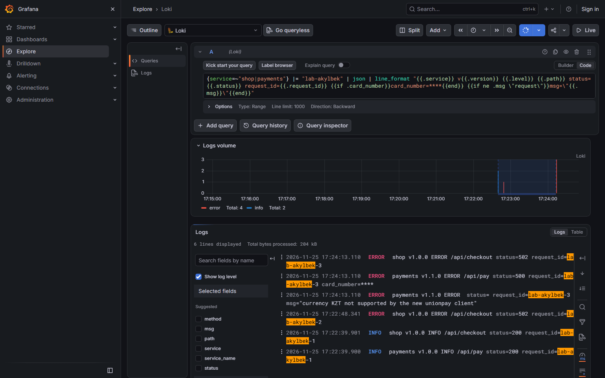

### Where the ID is passed on (`app/app.py`)

```python
# line 40 — every service takes the incoming ID or creates one
g.request_id = request.headers.get("X-Request-ID") or uuid.uuid4().hex[:16]
# line 52 — and returns it to the caller (the customer sees it in the response / error screen)
response.headers["X-Request-ID"] = g.request_id
# line 87-89 — the shop forwards it to payments  <-- the important line
req = urllib.request.Request(f"{PAYMENTS_URL}/api/pay", data=json.dumps(order).encode(),
                             headers={"Content-Type": "application/json",
                                      "X-Request-ID": g.request_id})  # pass it on!
```
**If the `"X-Request-ID": g.request_id` header were missing**, payments would not receive an ID and would
generate its own random one (line 40). Both services would still log, but with **different IDs**: the query
`|= "f6a3d075a1754aac"` would return only the shop's 502 line with `upstream_status=500` — and nothing about
*why* payments failed. To connect the two you would have to guess by timestamp and card type among dozens of
concurrent checkouts; with ~1.5 checkouts/s that is unreliable. The error message "currency KZT not supported"
would be lost from the customer's story.

### Why `service` is a Loki label but `request_id` is not

Loki indexes **only labels**; every unique combination of label values is a separate **stream** with its own
chunks and index entries. `service` has a handful of values (shop, payments, traffic, …) → a few streams, small
index, and it is exactly what you filter on first (`{service="shop"}`). `request_id` is unique per request →
millions of streams with one line each: the index would explode, chunks would be tiny and ingestion and queries
would slow down (high cardinality — the same reason it is not a Prometheus label). It is not needed as a label:
Loki selects the stream by `service`, then a line filter `|= "<id>"` or `| json | request_id="<id>"` scans the
content cheaply.

### Explain

**How does a request_id turn logs from two services into one story?** Each service only sees its half: the shop
knows the customer got a 502, payments knows why it returned 500. A shared ID, created at the edge, returned to
the customer and forwarded on every downstream call, is the join key: one query by the ID returns every line
of that one request from every service, in order — "who, what, where it broke and why", without guessing by
time.

**What would a trace add?** A trace (OpenTelemetry, Tempo/Jaeger) carries the same ID (trace id) but records
**spans**: the start, duration and parent of every step (shop handler → HTTP call → payments handler → DB …).
It shows the call tree and timing visually — where the time went (e.g. 40 ms in payments, 5 ms network),
which calls ran in parallel, retries, and it links to metrics (exemplars) and logs. Logs with a request_id give
the *events*; a trace gives the *structure and latency* of the whole request.


---

## Task 5 — The dashboard, as code

File: [`dashboards/shoplab.json`](dashboards/shoplab.json), provisioned by
`monitoring/grafana/dashboards/provider.yml` into the folder **lab14**, uid `shoplab-red`.

| # | Panel | Query | Unit |
|---|---|---|---|
| 1 | Rate by service/route | `sum by (job, route) (rate(http_requests_total[1m]))` | req/s (`reqps`) |
| 2 | 5xx ratio by service | `sum by (job) (rate(http_requests_total{status=~"5.."}[5m])) / sum by (job) (rate(http_requests_total[5m]))` | `percentunit` |
| 3 | p95 latency by route | `histogram_quantile(0.95, sum by (job, route, le) (rate(http_request_duration_seconds_bucket[5m])))` | `s` |
| 4 | Checkout error budget: burn rate | `slo:checkout_error_ratio:rate1h / 0.005` (+ 5m and 6h) — threshold lines at **6** (orange, ticket) and **14.4** (red, page) | `x` |
| 5 | Errors in logs (Loki) | `{service=~"shop\|payments"} \| json \| level="ERROR"` | logs |
| 6 | Checkout SLI (1h) | `1 - slo:checkout_error_ratio:rate1h`, green ≥ 99.5 % | `percentunit` |
| 7 | Payments restarts (1h) | `changes(process_start_time_seconds{job="payments"}[1h])` | — |
| 8 | Share of searches > 0.5 s | Task 1 bucket query | `percentunit` |

All time-series panels have `"min": 0` (y-axis from 0). Thresholds are drawn with
`"thresholdsStyle": {"mode": "line+area"}`.

**Loads by itself:** after `docker compose down && docker compose up -d` the dashboard is back without any
click (it lives in git and is mounted read-only into `/var/lib/grafana/dashboards`):

```bash
docker compose down && docker compose up -d
curl -s localhost:3000/api/dashboards/uid/shoplab-red | jq '.dashboard.title, (.dashboard.panels|length), .meta.provisioned'
```
Result at 15:22:06 (fresh containers, no volumes — Grafana's own database was empty):
```
alertmanager running alloy running grafana running loki running payments running prometheus running shop running traffic running webhook running
title: ShopLab — RED | panels: 10 | provisioned: True | folder: lab14
```
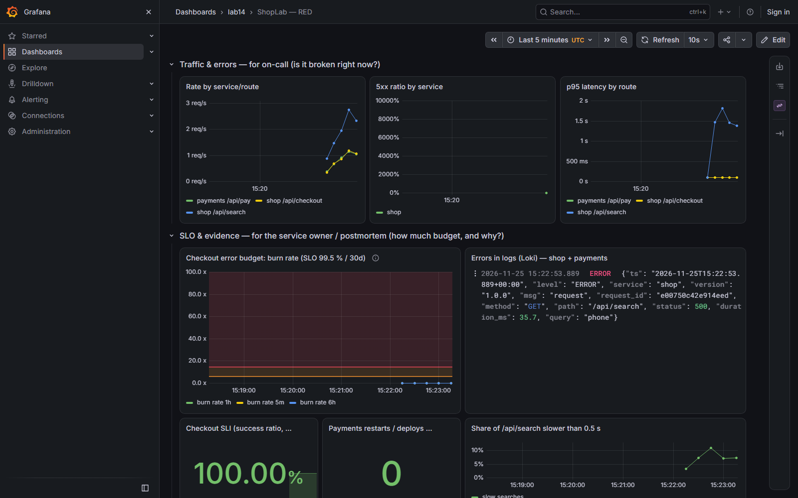

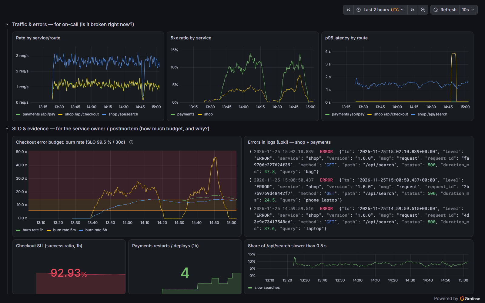

One gotcha found while building it: the burn-rate panel first showed **"No data"** instead of 0, because while
checkout had no 5xx yet the error series `http_requests_total{status=~"5.."}` for that route did not exist, so
the division returned an empty result. The recording rules now use `(sum(rate(...5xx...)) or vector(0)) / sum(rate(...))`
so the SLI is 0 % errors, not "unknown", on a healthy day — important for an SLO dashboard and for alerts that
compare against it.

### Explain

**Why keep dashboards in git instead of only in Grafana?** A dashboard clicked together in the UI lives only in
Grafana's database: it disappears with the container (as here — no volume), can be changed by anyone without
review, has no history and cannot be recreated in another environment. In git it is versioned (who changed
what and why, rollback), reviewed in pull requests together with the alert rules and recording rules it depends
on (if a rule is renamed, the dashboard change is in the same PR), and provisioned identically into every
environment — the same "everything as code" idea as the Compose file and the Prometheus rules.

**Who is each row for?**
- **Row 1 — Traffic & errors (RED: rate, errors, duration)** → the **on-call engineer** during an incident:
  "is it broken right now, which service, which route, is it errors or latency?" Seconds-to-minutes view.
- **Row 2 — SLO & evidence** → the **service owner / team lead / product** and the **postmortem author**:
  how much of the 30-day error budget is burning and how fast (burn rate vs 14.4 / 6), whether we are within
  the SLO (SLI stat), whether a deploy/restart happened, and the error log lines that explain *why* — the
  bridge from metric to log.


---

## Final Challenge

Reproduced in order: deploy 1.1.0 at 14:31:14 → (15 min) → `docker compose stop payments` 14:46:16 →
`start` 14:48:16 → (5 min) → rollback 14:53:17. Full analysis, impact, timeline with evidence, detection,
root cause and action items: **[`POSTMORTEM.md`](POSTMORTEM.md)**.

Key numbers: 165 of 1 448 checkouts failed (11.4 %) in 22 min → ~1.2 % of the 30-day error budget; first alert
5.6 min after deploy (`CheckoutErrorBudgetFastBurn`), first alert naming the cause 8 min after
(`HighErrorRatio job=payments`), `TargetDown` 70 s after the stop; rollback brought the error ratio to 0 by 14:58:50.

